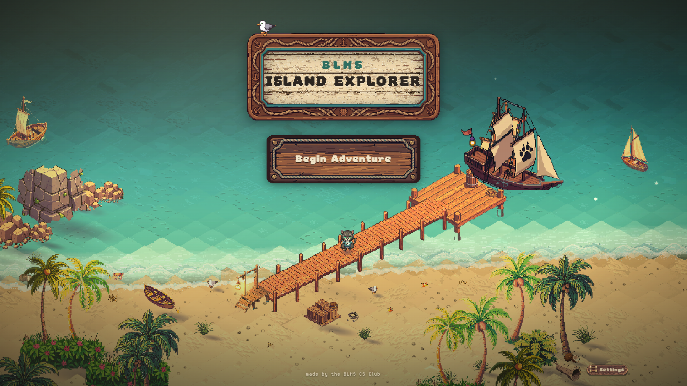

# BLHS Island Explorer

A game that shows Bonney Lake High School freshmen what the school has to offer: the clubs, the sports, the electives, the cords you can earn. You play as Thor, the school's panther, sail between islands, and every island is one real thing at the school. It runs in a browser on a school Chromebook with nothing to install.

Play it: https://blhs-island-explorer.vercel.app



## This repository

This is where the islands live, one folder each, written in Python by BLHS CS Club members. You own a folder, nobody else edits it, and you never touch the engine. What you write runs inside the real game next to everyone else's islands.

| Repository | What it is |
| --- | --- |
| [BLHS-Island-Explorer](https://github.com/BLHS-CS-Club/BLHS-Island-Explorer) | the islands, this one |
| [BLHS-Vine](https://github.com/BLHS-CS-Club/BLHS-Vine) | the engine that runs them |
| [MAPVIS](https://github.com/ashwath-polali/MAPVIS) | the map tool the islands are painted in |

## Working on an island

Open this folder in VS Code, open an island's `island.py` (start with `practice/starter/island.py`) and press the run button, the triangle at the top right of the file. Or type this in the terminal:

```
python play.py
```

A browser tab opens with the real game running your island. When you save a file the game reloads, and if your code has a mistake it shows on top of the game and in the terminal, with the file and the line. Python is the only thing you need installed, because play.py gets the game from the website and swaps your island's files into it.

When you want an island of your own, run `python play.py --new`. It asks for a name, copies `practice/starter` into `practice/<name>` with whatever you already wrote in it, and puts you on a branch with that name, so your work stays apart from everybody else's.

On a computer that doesn't have Git, like the ones at school, [download the folder](https://github.com/BLHS-CS-Club/BLHS-Island-Explorer/releases/download/download/cs-club-islands.zip), unzip it and open it in VS Code the same way.

## Giving your island its own map

Make the map in MAPVIS, name its spots and publish it. Then put the map's name on the `"map"` line of your `island.json` and press run, and the game opens your island on that map. The names you give `@on_talk` are the spot names you typed in MAPVIS, and if one is wrong the error lists the ones the map really has.

## Getting it into the game

Commit from the Source Control tab in VS Code and press Sync, which puts your branch on GitHub, then open a pull request. It only gets through if it changes nothing outside your own folder. The checks you can run yourself (`python tools/manifest.py` and `python -m unittest`) run on it, and a comment shows up with a link that plays your island in the real game. Ash plays it and merges it, and from then on the second link in that comment plays your island for anybody you send it to.

## The two rules

A word like `say` only does something if you put `yield` in front of it:

```python
yield say("You made it.")   # shows in the box and waits for the click
say("You made it.")         # nothing happens
```

You never call your own functions, because the game calls them when something happens:

```python
@on_talk("host")
def meet_the_president():
    yield say("You're new here.", who="host")
```

When the player walks to the spot named `host` and presses E, the game calls that function, and `@on_start` runs once when the island loads. Every word you can use is listed in [docs/VOCABULARY.md](docs/VOCABULARY.md).

## Where things are

- `play.py` runs the game on your island
- `practice/` is where your own island starts out, and `--new` copies `practice/starter` to make it
- `examples/` has seven small islands that each do one thing (talk, choices, remembering, arrows, a to-do list, a scored question, a cutscene)
- `islands/` has the finished islands, like `islands/atc` for the CS Club, and `islands/skeleton` is the template for one with its own map
- `docs/VOCABULARY.md` is every word, generated from the engine so it can't go out of date
- `tests/` is what runs on every pull request
- `vine.py` and `grape.py` are the words and the hooks, kept identical to the engine's copy

Until you give it a map of its own, your island runs in the CS Club room, and so do the examples. The room has four spots you can use: `host` (the club president), `the_desk` (a computer), `trophies` and `the_lab` (the whole room).

The CS Club at Bonney Lake High School makes this, and we meet Wednesdays after school from 2:15 to 3:30 in room 305.
